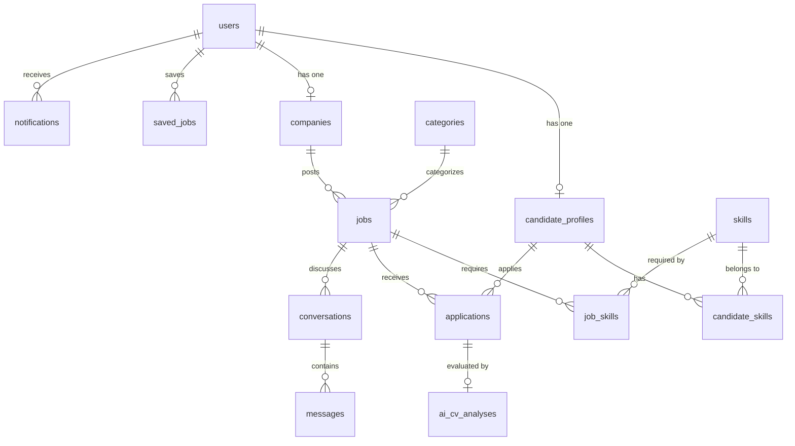

# TÀI LIỆU TOÀN DIỆN DÀNH CHO BACKEND DEVELOPER (TỪ A - Z)
> **Dự án:** Sàn Tìm Kiếm Việc Làm Online (TimViecOnline)  
> **Backend Framework:** Laravel 11 (PHP >= 8.2) | **Database:** MySQL (XAMPP / phpMyAdmin)  
> **Authentication:** Laravel Sanctum | **Realtime:** Laravel Reverb (WebSocket) | **AI Engine:** Google Gemini 1.5 Flash  
> **Tài liệu hợp nhất:** [docs/SRS.md](file:///D:/xampp/htdocs/tim-viec-online/docs/SRS.md) + [README.md](file:///D:/xampp/htdocs/tim-viec-online/README.md) + [db/tim_viec_online.sql](file:///D:/xampp/htdocs/tim-viec-online/db/tim_viec_online.sql)

---

## MỤC LỤC
1. [Kiến trúc hệ thống & Bản đồ thư mục](#1-kiến-trúc-hệ-thống--bản-đồ-thư-mục)
2. [Hướng dẫn cài đặt & Khởi chạy nhanh (Quick Start)](#2-hướng-dẫn-cài-đặt--khởi-chạy-nhanh-quick-start)
3. [Thuật ngữ, Phân vai & Ràng buộc chung](#3-thuật-ngữ-phân-vai--ràng-buộc-chung)
4. [Đặc tả chi tiết Nghiệp vụ Backend (FR-01 đến FR-10)](#4-đặc-tả-chi-tiết-nghiệp-vụ-backend-fr-01-đến-fr-10)
   - [FR-01: Đăng ký tài khoản & Tự động tạo hồ sơ](#fr-01-đăng-ký-tài-khoản)
   - [FR-02: Đăng nhập, Tạm khóa, Quên mật khẩu & Đổi mật khẩu](#fr-02-đăng-nhập-quên-mật-khẩu--khóa-tài-khoản)
   - [FR-03: Hồ sơ ứng viên & Tải lên file CV (PDF Preview)](#fr-03-hồ-sơ-ứng-viên--tải-lên-cv)
   - [FR-04: Hồ sơ công ty & Vòng đời tin tuyển dụng (Active/Closed)](#fr-04-hồ-sơ-công-ty-đăng-tin--quản-lý-vòng-đời-tin-tuyển-dụng)
   - [FR-05: Tìm kiếm, Bộ lọc đa tiêu chí & Đẩy tin tự động (Bump Job)](#fr-05-tìm-kiếm--bộ-lọc-việc-làm)
   - [FR-06: Ứng tuyển & Vòng đời xét duyệt hồ sơ](#fr-06-ứng-tuyển--quản-lý-vòng-đời-hồ-sơ)
   - [FR-07: Tích hợp Google Gemini AI phân tích CV (Match Score)](#fr-07-ai-phân-tích-cv--chấm-điểm-độ-phù-hợp-match-score)
   - [FR-08: Nhắn tin thời gian thực (Real-time Chat qua Reverb)](#fr-08-nhắn-tin-thời-gian-thực-real-time-chat)
   - [FR-09: Quản trị hệ thống, Kiểm duyệt tin & Master Data (Admin)](#fr-09-quản-trị-hệ-thống--kiểm-duyệt-tin-admin)
   - [FR-10: Hệ thống thông báo Web In-App (Notifications)](#fr-10-hệ-thống-thông-báo-trên-web-web-notifications)
5. [Yêu cầu phi chức năng (NFR-01 đến NFR-08) & Bảo mật](#5-yêu-cầu-phi-chức-năng-non-functional-requirements)
6. [Thiết kế Cơ sở dữ liệu chi tiết (Schema 15 bảng & Quan hệ Eloquent)](#6-thiết-kế-cơ-sở-dữ-liệu-chi-tiết)
7. [Đặc tả Danh sách RESTful API Endpoints đầy đủ (A-Z)](#7-đặc-tả-danh-sách-restful-api-endpoints-đầy-đủ)
8. [Quy chuẩn Response JSON & Bảng ánh xạ mã lỗi chuẩn SRS](#8-quy-chuẩn-response-json--bảng-ánh-xạ-mã-lỗi-chuẩn-srs)
9. [Hướng dẫn kỹ thuật lõi đặc thù (Gemini AI, Reverb WebSocket, Storage)](#9-hướng-dẫn-kỹ-thuật-lõi-đặc-thù)
10. [Dữ liệu kiểm thử mẫu & Hướng dẫn Test tự động](#10-dữ-liệu-kiểm-thử-mẫu--hướng-dẫn-test-tự-động)
11. [Kế hoạch phân công, Lộ trình 3 tuần & Quy tắc Git](#11-kế-hoạch-phân-công-lộ-trình-3-tuần--quy-tắc-git)

---

## 1. Kiến trúc hệ thống & Bản đồ thư mục

### 1.1. Công nghệ sử dụng
* **Kiến trúc Monorepo:** Cả Backend và Frontend nằm chung một Git Repository.
  * `backend/`: Laravel 11 RESTful API Service.
  * `frontend/`: Next.js 14+ App Router, Tailwind CSS, Axios, Laravel Echo.
  * `db/`: File dump cơ sở dữ liệu `tim_viec_online.sql`.
* **Môi trường Backend:** PHP >= 8.2, Composer, MySQL (XAMPP / Laragon).
* **Xác thực:** Laravel Sanctum (Stateful / Bearer Token).
* **Realtime:** Laravel Reverb (WebSocket server tích hợp chính chủ Laravel).
* **AI Engine:** Google Gemini API (`gemini-1.5-flash`) truyền trực tiếp văn bản/file PDF để trích xuất kỹ năng, kinh nghiệm và chấm điểm độ tương thích.

### 1.2. Bản đồ cây thư mục Backend (`/backend`)
```text
backend/
├── app/
│   ├── Http/
│   │   ├── Controllers/
│   │   │   └── Api/
│   │   │       ├── AuthController.php             # Đăng ký, đăng nhập, đổi mật khẩu, profile
│   │   │       ├── CandidateProfileController.php # Hồ sơ ứng viên, upload CV PDF, chọn kỹ năng
│   │   │       ├── CompanyController.php          # Hồ sơ công ty, danh sách công ty công khai
│   │   │       ├── JobController.php              # CRUD tin tuyển dụng, tìm kiếm lọc, bump tin, lưu tin
│   │   │       ├── ApplicationController.php      # Nộp đơn, rút đơn, duyệt trạng thái, gọi AI
│   │   │       ├── ChatController.php             # Danh sách hội thoại, gửi/nhận tin nhắn realtime
│   │   │       ├── NotificationController.php     # Danh sách thông báo, đánh dấu đã đọc
│   │   │       ├── CategoryController.php         # Ngành nghề (Public & Admin CRUD)
│   │   │       ├── SkillController.php            # Kỹ năng (Public & Admin CRUD)
│   │   │       └── AdminController.php            # Thống kê stats, khóa/mở user, xóa tin vi phạm
│   │   ├── Middleware/
│   │   │   ├── CheckRole.php                      # Kiểm tra vai trò: candidate, employer, admin
│   │   │   └── CheckUserLocked.php                # Chặn tài khoản bị Admin khóa
│   │   └── Requests/                              # FormRequest validate chuẩn nghiệp vụ SRS
│   ├── Models/                                    # 15 Eloquent Models thiết lập đầy đủ quan hệ
│   │   ├── User.php
│   │   ├── CandidateProfile.php
│   │   ├── Company.php
│   │   ├── Category.php
│   │   ├── Skill.php
│   │   ├── Job.php
│   │   ├── Application.php
│   │   ├── SavedJob.php
│   │   ├── AiCvAnalysis.php
│   │   ├── Conversation.php
│   │   ├── Message.php
│   │   └── Notification.php
│   ├── Services/
│   │   └── GeminiService.php                      # Đọc text từ CV PDF, prompt Gemini 1.5 Flash
│   └── Events/
│       └── MessageSent.php                        # Event broadcast WebSocket qua Reverb
├── config/
│   ├── queue.php                                  # Bảng queue_jobs (tránh xung đột với bảng jobs)
│   ├── broadcasting.php                           # Driver Reverb
│   └── cors.php                                   # CORS cho phép Frontend Next.js gọi API
├── database/
│   ├── migrations/                                # 15 bảng migration theo thứ tự khóa ngoại
│   └── seeders/                                   # DatabaseSeeder, dữ liệu mẫu chuẩn thực tế
├── routes/
│   ├── api.php                                    # Toàn bộ danh sách RESTful API endpoints
│   └── channels.php                               # Kênh riêng tư WebSocket (private-chat.{id})
├── storage/app/public/                            # Lưu trữ file công khai (avatars, logos, cvs)
└── test_all_backend.php                           # Script kiểm thử tự động toàn bộ API
```

---

## 2. Hướng dẫn cài đặt & Khởi chạy nhanh (Quick Start)

### 2.1. Cấu hình file `backend/.env`
Sao chép `.env.example` thành `.env` và kiểm tra các thông số bắt buộc:
```ini
APP_NAME=TimViecOnline
APP_ENV=local
APP_KEY=base64:... # Sinh bằng: php artisan key:generate
APP_DEBUG=true
APP_URL=http://localhost:8000

# Kết nối MySQL (Khởi động MySQL trong XAMPP trước)
DB_CONNECTION=mysql
DB_HOST=127.0.0.1
DB_PORT=3306
DB_DATABASE=tim_viec_online
DB_USERNAME=root
DB_PASSWORD=
DB_COLLATION=utf8mb4_unicode_ci

# Hệ thống lưu trữ file công khai (Avatar, Logo, CV PDF)
FILESYSTEM_DISK=public

# WebSocket Laravel Reverb (Realtime Chat)
BROADCAST_CONNECTION=reverb
REVERB_APP_ID=timviec_app
REVERB_APP_KEY=timviec_key
REVERB_APP_SECRET=timviec_secret
REVERB_HOST="localhost"
REVERB_PORT=8080
REVERB_SCHEME=http

# Google Gemini API Key (Dùng để phân tích CV & chấm Match Score)
GEMINI_API_KEY=your_gemini_api_key_here
```

### 2.2. Các bước khởi tạo lần đầu (Terminal commands)
```bash
# 1. Di chuyển vào thư mục backend
cd backend

# 2. Cài đặt các thư viện phụ thuộc PHP
composer install

# 3. Tạo symbolic link cho thư mục lưu trữ file (BẮT BUỘC để xem được avatar/CV)
php artisan storage:link

# 4. Khởi tạo cấu trúc bảng và nạp dữ liệu mẫu
php artisan migrate:fresh --seed

# 5. Khởi chạy máy chủ Backend API (Port 8000)
php artisan serve --port=8000

# 6. Khởi chạy máy chủ WebSocket Reverb (Mở 1 cửa sổ Terminal riêng)
php artisan reverb:start
```

---

## 3. Thuật ngữ, Phân vai & Ràng buộc chung

### 3.1. Thuật ngữ cốt lõi (Terminology)
| Thuật ngữ | Định nghĩa nghiệp vụ |
|---|---|
| **Khách (Guest)** | Người dùng chưa đăng nhập vào hệ thống. |
| **Ứng viên (Candidate)** | Người tìm việc có tài khoản cá nhân, hồ sơ kỹ năng và file CV PDF. |
| **Nhà tuyển dụng (Employer)** | Doanh nghiệp có tài khoản, hồ sơ công ty và quyền đăng tin tuyển dụng. |
| **Quản trị viên (Admin)** | Người quản trị hệ thống, có quyền kiểm duyệt tin tuyển dụng, khóa/mở khóa tài khoản và quản lý danh mục. |
| **JD (Job Description)** | Bản mô tả công việc, yêu cầu kỹ năng, kinh nghiệm và chế độ đãi ngộ của vị trí tuyển dụng. |
| **CV (Curriculum Vitae)** | Hồ sơ lý lịch năng lực của ứng viên, định dạng bắt buộc là file PDF. |
| **Match Score** | Điểm số tương thích giữa CV của ứng viên và tin tuyển dụng do AI chấm (thang điểm 0 - 100%). |
| **WebSocket** | Kênh truyền dữ liệu hai chiều tức thời (thông qua Laravel Reverb) phục vụ chức năng nhắn tin không cần reload. |

### 3.2. Phân vai người dùng & Quyền hạn
* **Guest:** Xem trang chủ, tìm kiếm việc làm, lọc việc làm, xem chi tiết công việc, xem chi tiết công ty, đăng ký tài khoản, đăng nhập, quên mật khẩu.
* **Candidate:** Toàn bộ quyền của Guest + Cập nhật hồ sơ cá nhân, chọn tối đa 10 kỹ năng, upload CV mặc định, xem trước CV, lưu/bỏ lưu việc làm, nộp đơn ứng tuyển (chọn CV cũ hoặc upload mới), rút đơn ứng tuyển (khi còn `applied`), xem kết quả AI Match Score, nhắn tin 1-1 với Nhà tuyển dụng, nhận thông báo in-app.
* **Employer:** Toàn bộ quyền của Guest + Cập nhật thông tin công ty (bắt buộc trước khi đăng bài), đăng tin tuyển dụng, chỉnh sửa tin, đóng/mở tin, xem danh sách ứng viên nộp vào tin của mình, xem CV, đổi trạng thái hồ sơ (`waiting`, `accepted`, `rejected`), nhắn tin 1-1 với ứng viên, nhận thông báo in-app.
* **Admin:** Dashboard thống kê tổng quan, quản lý người dùng (xem, tìm kiếm, khóa/mở khóa tài khoản), kiểm duyệt tin tuyển dụng (xóa tin vi phạm), CRUD danh mục ngành nghề (Categories) và kỹ năng (Skills).

### 3.3. Ràng buộc hệ thống chung
1. **Độ tuổi:** Người dùng đăng ký phải từ **15 tuổi trở lên** (theo Luật Lao động Việt Nam).
2. **File CV:** Định dạng bắt buộc là **PDF**, dung lượng file **tối đa 5 MB (5.120 KB)**.
3. **Tiền tệ & Ngày tháng:** Đơn vị tiền tệ hiển thị là **VNĐ** (ví dụ: `15.000.000 VNĐ`). Ngày tháng theo định dạng Việt Nam `DD/MM/YYYY`.
4. **Phạm vi hệ thống (Out of Scope):** Tập trung vào Upload CV PDF cá nhân hóa và Phân tích tương thích qua AI; **không** làm công cụ tạo CV kéo thả trực tuyến (CV Builder).

---

## 4. Đặc tả chi tiết Nghiệp vụ Backend (FR-01 đến FR-10)

Mọi quy định nghiệp vụ dưới đây bắt buộc phải được cài đặt chính xác trong Controllers, FormRequests, Models và Middleware của Backend:

### FR-01: Đăng ký tài khoản
* **Endpoint:** `POST /api/register`
* **Quy chuẩn dữ liệu đầu vào:**
  * `name`: Bắt buộc, độ dài **2 - 100 ký tự**, không chứa ký tự đặc biệt ngoài khoảng trắng và dấu gạch nối (Regex: `^[\pL\s-]+$`).
  * `email`: Bắt buộc, chuẩn RFC (ví dụ: `user@example.com`), kiểm tra **unique** trong bảng `users` (không phân biệt chữ hoa/chữ thường). Nếu trùng, trả về HTTP 422: `"Email đã được sử dụng"`.
  * `password`: Bắt buộc, độ dài **8 - 32 ký tự**, chứa ít nhất 1 chữ thường, 1 chữ hoa, 1 chữ số, 1 ký tự đặc biệt (Regex: `^(?=.*[a-z])(?=.*[A-Z])(?=.*\d)(?=.*[@$!%*?&])[A-Za-z\d@$!%*?&]{8,32}$`).
  * `password_confirmation`: Bắt buộc, trùng khớp 100% với `password`.
  * `phone`: Tùy chọn. Nếu có, bắt buộc đúng **10 chữ số** và bắt đầu bằng các đầu số hợp lệ của Việt Nam: `03`, `05`, `07`, `08`, `09` (Regex: `^(03|05|07|08|09)[0-9]{8}$`). Nếu sai, báo lỗi `"Số điện thoại không hợp lệ"`.
  * `role`: Bắt buộc, chỉ nhận giá trị: `candidate` hoặc `employer`.
* **Hành vi xử lý Backend:**
  * Mã hóa mật khẩu bằng thuật toán `Hash::make()` (Bcrypt).
  * Trạng thái mặc định của tài khoản là `active`, `failed_attempts = 0`.
  * **Tự động tạo bản ghi hồ sơ rỗng:**
    * Nếu `role == 'candidate'`: Tự động tạo bản ghi trong `candidate_profiles` với `user_id = $user->id`.
    * Nếu `role == 'employer'`: Tự động tạo bản ghi trong `companies` với `user_id = $user->id`.
  * Trả về thông báo thành công và thông tin người dùng (không chứa trường password).

### FR-02: Đăng nhập, Quên mật khẩu & Khóa tài khoản
* **Endpoint Đăng nhập:** `POST /api/login`
  * Kiểm tra tài khoản có tồn tại và đúng mật khẩu (`Hash::check`).
  * Nếu sai email hoặc mật khẩu: Trả về HTTP 401 với thông báo chuẩn: `"Email hoặc mật khẩu không chính xác"`.
  * **Cơ chế tạm khóa do brute-force:** Mỗi lần đăng nhập sai, tăng trường `failed_attempts` lên 1. Nếu đạt **5 lần liên tiếp**, tạm khóa tài khoản trong 15 phút (cập nhật `locked_until = now()->addMinutes(15)`). Khi người dùng cố đăng nhập tiếp trong thời gian này, trả về HTTP 403: `"Tài khoản bị tạm khóa do nhập sai nhiều lần, vui lòng thử lại sau 15 phút"`. Đăng nhập đúng sẽ reset `failed_attempts = 0`.
  * **Kiểm tra tài khoản bị Admin khóa:** Nếu `status == 'locked'`, từ chối đăng nhập với HTTP 403: `"Tài khoản của bạn đã bị khóa bởi quản trị viên"`.
  * Đăng nhập thành công: Cấp Sanctum Token (`createToken('auth_token')->plainTextToken`), trả về token, thông tin `user` kèm theo profile/company tương ứng.
* **Endpoint Đăng xuất:** `POST /api/logout` (Yêu cầu Token).
  * Thu hồi (revoke) token hiện tại: `$request->user()->currentAccessToken()->delete()`.
* **Endpoint Đổi mật khẩu:** `PUT /api/user/change-password` (Yêu cầu Token).
  * Nhập `current_password`, `password`, `password_confirmation`.
  * Kiểm tra `current_password` đúng: Nếu sai, trả về HTTP 400: `"Mật khẩu hiện tại không chính xác"`.
  * Kiểm tra mật khẩu mới không được trùng mật khẩu cũ: Nếu trùng, trả về HTTP 400: `"Mật khẩu mới không được trùng với mật khẩu hiện tại"`.
  * Mật khẩu mới phải thỏa mãn độ mạnh chuẩn FR-01.
* **Quên mật khẩu & Đặt lại:**
  * `POST /api/forgot-password`: Kiểm tra email tồn tại -> Sinh token bảo mật có hạn 15 phút lưu vào bảng `password_reset_tokens`.
  * `POST /api/reset-password`: Nhập `email`, `token`, `password`, `password_confirmation`. Nếu token hết hạn hoặc không tồn tại, trả về HTTP 400: `"Liên kết xác thực đã hết hạn hoặc không hợp lệ"`. Nếu hợp lệ, cập nhật mật khẩu mới và xóa token.

### FR-03: Hồ sơ ứng viên & Tải lên CV
* **Endpoint Xem hồ sơ:** `GET /api/candidate/profile`
* **Endpoint Cập nhật hồ sơ:** `POST /api/candidate/profile` (hỗ trợ `multipart/form-data`)
  * Các trường: `title`, `experience_years`, `bio`, `city`, `avatar` (ảnh: jpg, png, max 2MB), `social_links` (json hoặc string).
  * **Kỹ năng chuyên môn:** Cho phép chọn tối đa **10 kỹ năng** từ danh mục `skills` (đồng bộ vào bảng `candidate_skills`).
  * **File CV mặc định:**
    * Bắt buộc định dạng file là `.pdf`.
    * Dung lượng tối đa: **5 MB (5.120 KB)**.
    * Nếu file sai định dạng hoặc vượt quá 5MB, trả về HTTP 400: `"Chỉ chấp nhận file định dạng PDF dung lượng dưới 5MB"`.
    * File CV được lưu vào `storage/app/public/cvs/` và lưu đường dẫn vào cột `cv_file_path`.
    * Trả về đường dẫn xem trực tiếp (PDF Preview URL) dạng `http://localhost:8000/storage/cvs/filename.pdf` để trình duyệt xem trực tiếp, không ép tải về.

### FR-04: Hồ sơ công ty, Đăng tin & Quản lý vòng đời tin tuyển dụng
* **Hồ sơ doanh nghiệp:**
  * `GET /api/employer/company`: Xem thông tin công ty của NTD đang đăng nhập.
  * `POST /api/employer/company`: Cập nhật Tên công ty, Logo, Website, Quy mô (`size`), Địa chỉ trụ sở, Giới thiệu.
  * **Ràng buộc:** Nhà tuyển dụng **bắt buộc** phải có đầy đủ Tên công ty, Giới thiệu, Địa chỉ trụ sở và Tỉnh/Thành phố trước khi được phép đăng tin tuyển dụng đầu tiên.
* **Đăng tin tuyển dụng mới:** `POST /api/employer/jobs`
  * Tiêu đề việc làm: Bắt buộc, độ dài từ **10 đến 200 ký tự**.
  * Hạn chót nộp hồ sơ (`deadline`): Bắt buộc là ngày trong tương lai (lớn hơn ngày hiện tại ít nhất 1 ngày). Nếu chọn quá khứ hoặc hôm nay, trả về HTTP 400: `"Hạn nộp hồ sơ phải sau ngày hôm nay"`.
  * **Quy tắc nhập mức lương (3 trường hợp):**
    1. *Khoảng lương cụ thể:* Nhập `salary_min` và `salary_max`. Điều kiện: `salary_min <= salary_max` và cả 2 đều > 0. Nếu min > max, trả về HTTP 400: `"Mức lương tối thiểu không được lớn hơn mức lương tối đa"`.
    2. *Lương khởi điểm:* Nhập `salary_min`, để trống `salary_max` (`salary_type = 'from'`).
    3. *Lương thỏa thuận:* Tích chọn thỏa thuận (`salary_type = 'negotiable'`), cả `salary_min` và `salary_max` đều là `NULL`.
  * Trạng thái khởi tạo: Mặc định là `active` (Đang tuyển).
* **Đóng / Mở lại tin tuyển dụng:** `PATCH /api/employer/jobs/{id}/status`
  * Cho phép chuyển đổi qua lại giữa `active` và `closed`.
  * **Quy tắc khi Đóng tin (`closed`):**
    * **Ngừng nhận hồ sơ mới:** Nếu ứng viên gửi yêu cầu apply vào tin đã đóng hoặc quá hạn deadline, Backend trả về HTTP 422: `"Tin tuyển dụng này đã đóng hoặc đã hết hạn nộp hồ sơ"`.
    * **Bảo lưu và xử lý hồ sơ cũ:** Toàn bộ hồ sơ đã nộp trước đó vẫn được giữ nguyên vẹn trong DB. Nhà tuyển dụng vẫn có đầy đủ quyền xem danh sách ứng viên, mở xem CV, và cập nhật trạng thái duyệt hồ sơ.
    * **Bảo lưu hội thoại chat:** Các phòng chat giữa Nhà tuyển dụng và Ứng viên liên quan đến tin này vẫn hoạt động bình thường, tin nhắn vẫn gửi nhận realtime qua Reverb.
    * **Mở lại tin:** Nhà tuyển dụng có quyền đổi lại trạng thái `active` bất cứ lúc nào.
* **Xem trang công ty công khai:** `GET /api/companies/{id}` (Public)
  * Trả về thông tin công ty và danh sách các tin tuyển dụng đang mở (`status = 'active'` và `deadline >= today`) của công ty đó.

### FR-05: Tìm kiếm & Bộ lọc việc làm
* **Endpoint:** `GET /api/jobs` (Public)
* **Các tham số lọc (Query Params):**
  * `keyword`: Tìm kiếm không phân biệt chữ hoa/thường, không dấu/có dấu trên Tiêu đề công việc (`title`), Tên công ty (`companies.name`) hoặc Kỹ năng yêu cầu (`skills.name`).
  * `category_id`: Lọc theo ID danh mục ngành nghề (hỗ trợ 1 hoặc nhiều ID mảng `category_id[]=1&category_id[]=2`).
  * `city`: Lọc theo Tỉnh/Thành phố làm việc (Hà Nội, TP.HCM, Đà Nẵng,...).
  * `job_type`: Lọc theo hình thức làm việc (`full-time`, `part-time`, `remote`, `internship`).
  * `salary`: Lọc theo khoảng mức lương thực tế:
    * `under_10m`: Lấy các tin có `salary_max < 10000000` (hoặc `salary_min < 10000000` với lương khởi điểm).
    * `10m_20m`: Lấy các tin có `salary_max >= 10000000` và `salary_min <= 20000000`.
    * `above_20m`: Lấy các tin có `salary_min > 20000000`.
    * `negotiable`: Lấy các tin có `salary_type = 'negotiable'`.
  * `page` & `limit`: Phân trang kết quả (mặc định 10 bản ghi/trang).
* **Thứ tự sắp xếp & Cơ chế Đẩy tin tự động (Bump Job):**
  * Danh sách việc làm được sắp xếp theo `ORDER BY updated_at DESC`.
  * **Cơ chế Bump tin tự động:** Khi có bất kỳ ứng viên nào nộp hồ sơ ứng tuyển (`apply`) vào tin tuyển dụng thành công, Backend sẽ tự động cập nhật trường thời gian của tin tuyển dụng (`$job->touch()` hoặc `$job->update(['updated_at' => now()])`). Nhờ đó, các tin tuyển dụng có tương tác thực tế sẽ tự động nhảy lên đầu trang danh sách tìm kiếm mà Nhà tuyển dụng không cần thao tác thủ công.
* **Lưu / Bỏ lưu việc làm:**
  * `POST /api/jobs/{id}/save`: Ứng viên lưu việc làm vào bảng `saved_jobs`.
  * `DELETE /api/jobs/{id}/save`: Ứng viên bỏ lưu việc làm.
  * `GET /api/candidate/saved-jobs`: Xem danh sách việc làm đã lưu của ứng viên.

### FR-06: Ứng tuyển & Quản lý vòng đời hồ sơ
* **Nộp hồ sơ ứng tuyển:** `POST /api/jobs/{id}/apply` (Role: `candidate`)
  * Kiểm tra tin tuyển dụng: Phải có `status = 'active'` và `deadline >= today`. Nếu không, trả về HTTP 422: `"Tin tuyển dụng này đã đóng hoặc đã hết hạn nộp hồ sơ"`.
  * **Chặn nộp trùng:** Một ứng viên chỉ được nộp đơn **duy nhất 1 lần** cho cùng một tin tuyển dụng. Nếu đã nộp trước đó (đơn chưa bị rút), trả về HTTP 409: `"Bạn đã nộp hồ sơ cho công việc này rồi"`.
  * **Hình thức nộp CV:**
    * *Dùng CV mặc định:* Chọn `cv_source = 'default'`. Hệ thống lấy đường dẫn `cv_file_path` từ `candidate_profiles`. Nếu ứng viên chưa có CV mặc định, báo lỗi yêu cầu upload.
    * *Upload CV mới:* Chọn `cv_source = 'new'`, gửi kèm file `cv_file` (định dạng PDF, dung lượng <= 5MB). File được lưu vào `storage/app/public/application_cvs/`.
  * Kèm `cover_letter` (thư giới thiệu, tối đa 2000 ký tự).
  * Trạng thái khởi tạo của đơn: `applied`.
  * Kích hoạt Bump tin (`$job->touch()`).
  * Tự động gửi thông báo in-app cho Nhà tuyển dụng của công việc đó.
* **Vòng đời 4 trạng thái của đơn ứng tuyển (`status`):**
  1. `applied` (Đã ứng tuyển): Trạng thái ban đầu ngay khi ứng viên nộp hồ sơ thành công.
  2. `waiting` (Đang xem xét): Tự động chuyển từ `applied` sang `waiting` ngay khi Nhà tuyển dụng bấm vào xem chi tiết đơn ứng tuyển (`GET /api/employer/applications/{id}`) lần đầu tiên.
  3. `accepted` (Trúng tuyển): Nhà tuyển dụng chủ động phê duyệt hồ sơ.
  4. `rejected` (Từ chối): Nhà tuyển dụng từ chối hồ sơ chưa phù hợp.
* **Rút hồ sơ ứng tuyển:** `DELETE /api/candidate/applications/{id}/withdraw`
  * Ứng viên **chỉ được phép rút hồ sơ khi đơn còn ở trạng thái `applied`**.
  * Nếu Nhà tuyển dụng đã mở xem đơn (trạng thái đã chuyển sang `waiting`, `accepted` hoặc `rejected`), hệ thống ngăn chặn việc rút đơn và trả về HTTP 400: `"Nhà tuyển dụng đã xem hồ sơ của bạn, không thể rút đơn"`.
* **Lịch sử ứng tuyển:** `GET /api/candidate/applications`
  * Trả về danh sách tất cả các đơn đã nộp kèm thông tin công việc, tên công ty, ngày nộp, trạng thái và kết quả AI Match Score.

### FR-07: AI Phân tích CV & Chấm điểm độ phù hợp (Match Score)
* **Quy trình hoạt động:**
  * Ngay khi đơn ứng tuyển được tạo thành công, Backend kích hoạt phân tích AI (gọi trực tiếp hoặc qua Queue Job).
  * Đọc nội dung văn bản từ file CV PDF của ứng viên và nội dung JD (tiêu đề, yêu cầu, kỹ năng) của công việc.
  * Gửi dữ liệu sang **Google Gemini 1.5 Flash API**.
* **Thuật toán đánh giá 4 tiêu chí trọng số:**
  1. *Kỹ năng chuyên môn (Trọng số 40%):* Mức độ trùng khớp giữa kỹ năng CV có và kỹ năng JD yêu cầu.
  2. *Kinh nghiệm làm việc (Trọng số 30%):* Số năm kinh nghiệm và vị trí tương đương.
  3. *Học vấn & Chứng chỉ (Trọng số 15%):* Chuyên ngành đào tạo và chứng chỉ nghề nghiệp.
  4. *Định hướng & Ngoại ngữ (Trọng số 15%):* Trình độ ngoại ngữ và mục tiêu nghề nghiệp.
* **Yêu cầu đầu ra từ AI:**
  * `match_score`: Số nguyên từ **0 đến 100**.
  * `strengths`: Mảng từ **2 đến 4 điểm mạnh** phù hợp nhất.
  * `missing_skills`: Mảng từ **1 đến 4 kỹ năng còn thiếu** mà JD đòi hỏi nhưng CV chưa có.
  * `summary` / `suggestions`: Đoạn nhận xét tổng quan ngắn gọn dưới **80 từ**.
* **Lưu trữ vĩnh viễn:** Kết quả được lưu vào bảng `ai_cv_analyses` gắn với `application_id`. Cả Nhà tuyển dụng và Ứng viên khi mở lại hồ sơ sẽ lấy trực tiếp từ DB mà không gọi lại AI (tiết kiệm chi phí và tối ưu tốc độ phản hồi).

### FR-08: Nhắn tin thời gian thực (Real-time Chat)
* **Điều kiện mở cuộc trò chuyện:**
  * Phòng trò chuyện (`conversations`) được tạo giữa Ứng viên và Nhà tuyển dụng gắn với một tin tuyển dụng cụ thể (`job_id`).
  * Chỉ được phép tạo chat khi ứng viên **đã nộp đơn ứng tuyển** vào tin tuyển dụng đó.
* **Gửi nhận tin nhắn:**
  * `POST /api/conversations/{id}/messages`: Gửi tin nhắn văn bản (độ dài **1 đến 1.000 ký tự**, không nhận chuỗi rỗng toàn khoảng trắng).
  * Backend lưu tin nhắn vào bảng `messages` với `is_read = 0`.
  * Backend phát sóng Broadcast Event `MessageSent` qua WebSocket channel `private-chat.{conversationId}` (sử dụng Laravel Reverb).
  * Độ trễ chuyển phát tin nhắn đến màn hình đối phương yêu cầu **dưới 1 giây**.
* **Bảo mật kênh truyền:**
  * Trong `routes/channels.php`, kiểm tra chặt chẽ quyền truy cập: Chỉ user có `id == candidate_id` hoặc `id == employer_id` của cuộc trò chuyện mới được phép kết nối vào channel. Ngăn chặn tuyệt đối hành vi xem trộm tin nhắn.
* **Duy trì chat khi tin đóng:**
  * Ngay cả khi tin tuyển dụng bị đóng hoặc hết hạn, phòng chat giữa hai bên vẫn hoạt động bình thường để trao đổi phỏng vấn.

### FR-09: Quản trị hệ thống & Kiểm duyệt tin (Admin)
* **Dashboard Thống kê:** `GET /api/admin/stats`
  * Trả về tổng số: Ứng viên, Nhà tuyển dụng, Việc làm đang hoạt động, Đơn ứng tuyển và danh sách việc làm mới nhất.
* **Quản lý người dùng:**
  * `GET /api/admin/users`: Danh sách toàn bộ tài khoản, tìm kiếm theo tên/email, lọc theo role (`candidate`, `employer`), lọc theo trạng thái (`active`, `locked`).
  * `PATCH /api/admin/users/{id}/status`: Khóa (`locked`) hoặc Mở khóa (`active`) tài khoản. Khi tài khoản bị khóa, hệ thống lập tức thu hồi token phiên làm việc hiện tại của user đó.
* **Kiểm duyệt tin tuyển dụng:**
  * `GET /api/admin/jobs`: Danh sách tin tuyển dụng trên hệ thống.
  * `DELETE /api/admin/jobs/{id}`: Quản trị viên xóa tin tuyển dụng vi phạm chính sách kèm thông báo.
* **Quản lý Master Data:**
  * CRUD Ngành nghề (`/api/admin/categories`).
  * CRUD Kỹ năng (`/api/admin/skills`).

### FR-10: Hệ thống thông báo trên Web (Web Notifications)
* **Kích hoạt thông báo tự động:**
  * Khi có ứng viên nộp hồ sơ mới -> Gửi thông báo cho Nhà tuyển dụng.
  * Khi Nhà tuyển dụng cập nhật trạng thái hồ sơ (`accepted`, `rejected`) -> Gửi thông báo cho Ứng viên.
  * Khi đối phương gửi tin nhắn mới trong phòng chat -> Gửi thông báo cho người nhận.
* **Trải nghiệm thông báo:**
  * `GET /api/notifications`: Lấy danh sách thông báo của user (kèm trường đếm số thông báo chưa đọc `unread_count`).
  * `PATCH /api/notifications/{id}/read`: Đánh dấu 1 thông báo đã đọc.
  * `PATCH /api/notifications/read-all`: Đánh dấu tất cả thông báo là đã đọc.

---

## 5. Yêu cầu phi chức năng (Non-Functional Requirements)

Backend Developer cần đảm bảo tuân thủ nghiêm ngặt 8 tiêu chuẩn sau trong từng dòng mã:

| Mã | Nhóm | Yêu cầu kỹ thuật |
|---|---|---|
| **NFR-01** | **Thời gian phản hồi** | 95% các API tải trang, tìm kiếm việc làm và xem chi tiết công việc có thời gian phản hồi **dưới 1,5 giây** trong điều kiện 50 người dùng truy cập đồng thời. |
| **NFR-02** | **Thời gian xử lý AI** | Thời gian từ lúc nộp đơn đến khi nhận kết quả phân tích AI đạt trung bình **dưới 4 giây**. |
| **NFR-03** | **Độ trễ tin nhắn** | Tin nhắn phát qua WebSocket Reverb hiển thị trên màn hình người nhận trong vòng **dưới 1 giây**. |
| **NFR-04** | **Độ sẵn sàng (Uptime)** | Hệ thống duy trì thời gian hoạt động liên tục tối thiểu **99%**. |
| **NFR-05** | **Bảo mật mật khẩu** | 100% mật khẩu được mã hóa một chiều bằng thuật toán **Bcrypt** (`Hash::make`). Tuyệt đối không lưu văn bản thuần. |
| **NFR-06** | **Chống tấn công dữ liệu** | 100% câu truy vấn phải sử dụng Eloquent ORM / Query Builder với cơ chế Parameter Binding để chống triệt để **SQL Injection**. Validate dữ liệu đầu vào bằng `FormRequest`. |
| **NFR-07** | **Khả năng tương thích** | Dữ liệu trả về đúng chuẩn JSON, hỗ trợ tốt cho giao diện hiển thị từ màn hình di động **360px** trở lên. |
| **NFR-08** | **Định dạng chuẩn** | Format tiền tệ theo đơn vị VNĐ, ngày tháng theo chuẩn ISO 8601 (`YYYY-MM-DDTHH:mm:ssZ`) để Frontend format thành `DD/MM/YYYY`. |

---

## 6. Thiết kế Cơ sở dữ liệu chi tiết

Cơ sở dữ liệu bao gồm **15 bảng** (đã đồng bộ trong file `db/tim_viec_online.sql` và các file migration Laravel):



### 6.1. Bảng `users` (Tài khoản người dùng)
* `id`: BIGINT UNSIGNED AUTO_INCREMENT PRIMARY KEY
* `name`: VARCHAR(100) NOT NULL
* `email`: VARCHAR(191) NOT NULL UNIQUE
* `password`: VARCHAR(255) NOT NULL (Bcrypt)
* `phone`: VARCHAR(15) NULL
* `role`: ENUM('candidate', 'employer', 'admin') NOT NULL DEFAULT 'candidate'
* `status`: ENUM('active', 'locked') NOT NULL DEFAULT 'active'
* `failed_attempts`: INT NOT NULL DEFAULT 0
* `locked_until`: TIMESTAMP NULL
* `created_at`, `updated_at`: TIMESTAMP

### 6.2. Bảng `candidate_profiles` (Hồ sơ ứng viên)
* `id`: BIGINT UNSIGNED AUTO_INCREMENT PRIMARY KEY
* `user_id`: BIGINT UNSIGNED NOT NULL UNIQUE (FK -> `users.id` ON DELETE CASCADE)
* `title`: VARCHAR(191) NULL (ví dụ: "Lập trình viên Backend PHP")
* `experience_years`: INT NULL DEFAULT 0
* `bio`: TEXT NULL
* `avatar`: VARCHAR(255) NULL
* `city`: VARCHAR(100) NULL
* `cv_file_path`: VARCHAR(255) NULL (Đường dẫn file PDF trong storage)
* `social_links`: JSON NULL
* `created_at`, `updated_at`: TIMESTAMP

### 6.3. Bảng `companies` (Hồ sơ doanh nghiệp)
* `id`: BIGINT UNSIGNED AUTO_INCREMENT PRIMARY KEY
* `user_id`: BIGINT UNSIGNED NOT NULL UNIQUE (FK -> `users.id` ON DELETE CASCADE)
* `name`: VARCHAR(191) NOT NULL
* `logo`: VARCHAR(255) NULL
* `website`: VARCHAR(191) NULL
* `company_size`: VARCHAR(50) NULL (ví dụ: "50-100 nhân viên")
* `address`: VARCHAR(255) NULL
* `city`: VARCHAR(100) NULL
* `description`: TEXT NULL
* `created_at`, `updated_at`: TIMESTAMP

### 6.4. Bảng `categories` (Danh mục ngành nghề)
* `id`: BIGINT UNSIGNED AUTO_INCREMENT PRIMARY KEY
* `name`: VARCHAR(100) NOT NULL
* `slug`: VARCHAR(100) NOT NULL UNIQUE
* `icon`: VARCHAR(100) NULL
* `created_at`, `updated_at`: TIMESTAMP

### 6.5. Bảng `skills` (Kỹ năng)
* `id`: BIGINT UNSIGNED AUTO_INCREMENT PRIMARY KEY
* `name`: VARCHAR(100) NOT NULL UNIQUE
* `created_at`, `updated_at`: TIMESTAMP

### 6.6. Bảng `candidate_skills` (Kỹ năng ứng viên — Tối đa 10 kỹ năng)
* `candidate_profile_id`: BIGINT UNSIGNED NOT NULL (FK -> `candidate_profiles.id` ON DELETE CASCADE)
* `skill_id`: BIGINT UNSIGNED NOT NULL (FK -> `skills.id` ON DELETE CASCADE)
* PRIMARY KEY (`candidate_profile_id`, `skill_id`)

### 6.7. Bảng `jobs` (Tin tuyển dụng)
* `id`: BIGINT UNSIGNED AUTO_INCREMENT PRIMARY KEY
* `company_id`: BIGINT UNSIGNED NOT NULL (FK -> `companies.id` ON DELETE CASCADE)
* `category_id`: BIGINT UNSIGNED NOT NULL (FK -> `categories.id` ON DELETE RESTRICT)
* `title`: VARCHAR(200) NOT NULL
* `description`: TEXT NOT NULL
* `requirements`: TEXT NOT NULL
* `benefits`: TEXT NULL
* `salary_type`: ENUM('range', 'from', 'negotiable') NOT NULL DEFAULT 'range'
* `salary_min`: DECIMAL(12,2) NULL
* `salary_max`: DECIMAL(12,2) NULL
* `job_type`: ENUM('full-time', 'part-time', 'remote', 'internship') NOT NULL DEFAULT 'full-time'
* `experience_level`: VARCHAR(50) NULL (ví dụ: "1 - 3 năm")
* `quantity`: INT NOT NULL DEFAULT 1
* `city`: VARCHAR(100) NOT NULL
* `work_location`: VARCHAR(255) NULL
* `deadline`: DATE NOT NULL
* `status`: ENUM('active', 'closed') NOT NULL DEFAULT 'active'
* `created_at`, `updated_at`: TIMESTAMP (cập nhật khi bump tin)

### 6.8. Bảng `job_skills` (Kỹ năng yêu cầu cho việc làm)
* `job_id`: BIGINT UNSIGNED NOT NULL (FK -> `jobs.id` ON DELETE CASCADE)
* `skill_id`: BIGINT UNSIGNED NOT NULL (FK -> `skills.id` ON DELETE CASCADE)
* PRIMARY KEY (`job_id`, `skill_id`)

### 6.9. Bảng `applications` (Đơn ứng tuyển)
* `id`: BIGINT UNSIGNED AUTO_INCREMENT PRIMARY KEY
* `job_id`: BIGINT UNSIGNED NOT NULL (FK -> `jobs.id` ON DELETE CASCADE)
* `candidate_id`: BIGINT UNSIGNED NOT NULL (FK -> `users.id` ON DELETE CASCADE)
* `cv_path`: VARCHAR(255) NOT NULL
* `cover_letter`: TEXT NULL
* `status`: ENUM('applied', 'waiting', 'accepted', 'rejected') NOT NULL DEFAULT 'applied'
* `applied_at`: TIMESTAMP NOT NULL DEFAULT CURRENT_TIMESTAMP
* `created_at`, `updated_at`: TIMESTAMP
* UNIQUE KEY (`job_id`, `candidate_id`) — Chặn nộp trùng lần 2

### 6.10. Bảng `saved_jobs` (Việc làm đã lưu)
* `id`: BIGINT UNSIGNED AUTO_INCREMENT PRIMARY KEY
* `candidate_id`: BIGINT UNSIGNED NOT NULL (FK -> `users.id` ON DELETE CASCADE)
* `job_id`: BIGINT UNSIGNED NOT NULL (FK -> `jobs.id` ON DELETE CASCADE)
* `created_at`: TIMESTAMP DEFAULT CURRENT_TIMESTAMP
* UNIQUE KEY (`candidate_id`, `job_id`)

### 6.11. Bảng `ai_cv_analyses` (Kết quả phân tích CV từ Gemini AI)
* `id`: BIGINT UNSIGNED AUTO_INCREMENT PRIMARY KEY
* `application_id`: BIGINT UNSIGNED NOT NULL UNIQUE (FK -> `applications.id` ON DELETE CASCADE)
* `match_score`: INT NOT NULL (0 đến 100)
* `summary`: TEXT NULL (Dưới 80 từ)
* `strengths`: JSON NULL (Mảng 2 đến 4 điểm mạnh)
* `missing_skills`: JSON NULL (Mảng 1 đến 4 kỹ năng còn thiếu)
* `recommendations`: JSON NULL
* `created_at`, `updated_at`: TIMESTAMP

### 6.12. Bảng `conversations` (Phòng trò chuyện 1-1)
* `id`: BIGINT UNSIGNED AUTO_INCREMENT PRIMARY KEY
* `job_id`: BIGINT UNSIGNED NOT NULL (FK -> `jobs.id` ON DELETE CASCADE)
* `candidate_id`: BIGINT UNSIGNED NOT NULL (FK -> `users.id` ON DELETE CASCADE)
* `employer_id`: BIGINT UNSIGNED NOT NULL (FK -> `users.id` ON DELETE CASCADE)
* `created_at`, `updated_at`: TIMESTAMP
* UNIQUE KEY (`job_id`, `candidate_id`, `employer_id`)

### 6.13. Bảng `messages` (Tin nhắn trò chuyện)
* `id`: BIGINT UNSIGNED AUTO_INCREMENT PRIMARY KEY
* `conversation_id`: BIGINT UNSIGNED NOT NULL (FK -> `conversations.id` ON DELETE CASCADE)
* `sender_id`: BIGINT UNSIGNED NOT NULL (FK -> `users.id` ON DELETE CASCADE)
* `message`: TEXT NOT NULL (1 đến 1000 ký tự)
* `is_read`: TINYINT(1) NOT NULL DEFAULT 0
* `created_at`: TIMESTAMP DEFAULT CURRENT_TIMESTAMP

### 6.14. Bảng `notifications` (Thông báo In-App)
* `id`: BIGINT UNSIGNED AUTO_INCREMENT PRIMARY KEY
* `user_id`: BIGINT UNSIGNED NOT NULL (FK -> `users.id` ON DELETE CASCADE)
* `type`: VARCHAR(50) NOT NULL
* `title`: VARCHAR(191) NOT NULL
* `message`: TEXT NOT NULL
* `data`: JSON NULL
* `is_read`: TINYINT(1) NOT NULL DEFAULT 0
* `created_at`, `updated_at`: TIMESTAMP

### 6.15. Bảng `password_reset_tokens` (Token đặt lại mật khẩu)
* `email`: VARCHAR(191) NOT NULL PRIMARY KEY
* `token`: VARCHAR(255) NOT NULL
* `created_at`: TIMESTAMP NULL

---

## 7. Đặc tả Danh sách RESTful API Endpoints đầy đủ

### 7.1. Module Xác thực & Tài khoản (`/api`)
| Method | Endpoint | Quyền | Mục đích | Body / Params |
|---|---|---|---|---|
| `POST` | `/api/register` | Public | Đăng ký tài khoản | `name`, `email`, `password`, `password_confirmation`, `phone`, `role` |
| `POST` | `/api/login` | Public | Đăng nhập -> Cấp token | `email`, `password` |
| `POST` | `/api/logout` | Auth | Đăng xuất -> Thu hồi token | None |
| `GET` | `/api/user` | Auth | Lấy thông tin user hiện tại kèm profile | None |
| `PUT` | `/api/user/change-password` | Auth | Đổi mật khẩu | `current_password`, `password`, `password_confirmation` |
| `POST` | `/api/forgot-password` | Public | Gửi email đặt lại mật khẩu | `email` |
| `POST` | `/api/reset-password` | Public | Đặt lại mật khẩu bằng token | `email`, `token`, `password`, `password_confirmation` |

### 7.2. Module Dữ liệu danh mục & Công ty (Public)
| Method | Endpoint | Quyền | Mục đích | Body / Params |
|---|---|---|---|---|
| `GET` | `/api/categories` | Public | Danh sách ngành nghề | None |
| `GET` | `/api/categories/{id}` | Public | Chi tiết 1 ngành nghề | None |
| `GET` | `/api/skills` | Public | Danh sách kỹ năng | None |
| `GET` | `/api/skills/{id}` | Public | Chi tiết 1 kỹ năng | None |
| `GET` | `/api/companies` | Public | Danh sách công ty nổi bật | `?page=&limit=` |
| `GET` | `/api/companies/{id}` | Public | Chi tiết công ty & jobs đang mở | None |

### 7.3. Module Tìm kiếm & Quản lý Việc làm
| Method | Endpoint | Quyền | Mục đích | Body / Params |
|---|---|---|---|---|
| `GET` | `/api/jobs` | Public | Tìm kiếm & Lọc việc làm (sắp xếp theo `updated_at DESC`) | `?keyword=&category_id=&city=&job_type=&salary=&page=` |
| `GET` | `/api/jobs/{id}` | Public | Xem chi tiết tin tuyển dụng | None |
| `POST` | `/api/employer/jobs` | Employer | Đăng tin tuyển dụng mới | `title`, `category_id`, `description`, `requirements`, `benefits`, `salary_type`, `salary_min`, `salary_max`, `job_type`, `city`, `deadline`, `skill_ids` |
| `PUT` | `/api/employer/jobs/{id}` | Employer | Chỉnh sửa tin tuyển dụng | Cùng các trường như đăng tin |
| `PATCH` | `/api/employer/jobs/{id}/status` | Employer | Đóng hoặc mở lại tin (`active`/`closed`) | `status` |
| `GET` | `/api/employer/my-jobs` | Employer | Danh sách tin công ty đã đăng | None |
| `POST` | `/api/jobs/{id}/save` | Candidate | Lưu việc làm yêu thích | None |
| `DELETE` | `/api/jobs/{id}/save` | Candidate | Bỏ lưu việc làm | None |
| `GET` | `/api/candidate/saved-jobs` | Candidate | Danh sách các việc làm đã lưu | None |

### 7.4. Module Hồ sơ Người dùng
| Method | Endpoint | Quyền | Mục đích | Body / Params |
|---|---|---|---|---|
| `GET` | `/api/candidate/profile` | Candidate | Xem hồ sơ ứng viên cá nhân | None |
| `POST` | `/api/candidate/profile` | Candidate | Cập nhật hồ sơ & upload CV mặc định | `title`, `experience_years`, `bio`, `city`, `avatar`, `cv_file` (PDF <= 5MB), `skills` (tối đa 10) |
| `GET` | `/api/employer/company` | Employer | Xem thông tin công ty của mình | None |
| `POST` | `/api/employer/company` | Employer | Cập nhật thông tin công ty | `name`, `logo`, `website`, `company_size`, `address`, `city`, `description` |

### 7.5. Module Đơn ứng tuyển & Chấm điểm AI
| Method | Endpoint | Quyền | Mục đích | Body / Params |
|---|---|---|---|---|
| `POST` | `/api/jobs/{id}/apply` | Candidate | Nộp hồ sơ ứng tuyển | `cv_source` (`default` / `new`), `cv_file` (PDF), `cover_letter` |
| `DELETE` | `/api/candidate/applications/{id}/withdraw` | Candidate | Rút đơn ứng tuyển (chỉ khi `applied`) | None |
| `GET` | `/api/candidate/applications` | Candidate | Xem lịch sử các đơn đã nộp | None |
| `GET` | `/api/employer/jobs/{id}/applications` | Employer | Xem danh sách ứng viên nộp vào job | None |
| `GET` | `/api/employer/applications/{id}` | Employer | Xem chi tiết 1 đơn (auto chuyển sang `waiting`) | None |
| `PATCH` | `/api/employer/applications/{id}/status` | Employer | Duyệt trạng thái (`accepted`/`rejected`) | `status` |
| `POST` | `/api/applications/{id}/ai-analyze` | Auth | Kích hoạt AI phân tích lại đơn | None |

### 7.6. Module Nhắn tin Realtime & Thông báo
| Method | Endpoint | Quyền | Mục đích | Body / Params |
|---|---|---|---|---|
| `GET` | `/api/conversations` | Auth | Danh sách phòng chat của user | None |
| `POST` | `/api/conversations` | Auth | Mở cuộc trò chuyện mới giữa NTD và Ứng viên | `job_id`, `candidate_id` |
| `GET` | `/api/conversations/{id}/messages` | Auth | Lịch sử tin nhắn theo phòng | `?page=&limit=` |
| `POST` | `/api/conversations/{id}/messages` | Auth | Gửi tin nhắn & bắn sự kiện Reverb | `message` (1 - 1000 ký tự) |
| `GET` | `/api/notifications` | Auth | Danh sách thông báo in-app | None |
| `PATCH` | `/api/notifications/{id}/read` | Auth | Đánh dấu 1 thông báo đã đọc | None |
| `PATCH` | `/api/notifications/read-all` | Auth | Đánh dấu tất cả thông báo đã đọc | None |

### 7.7. Module Quản trị viên (Admin)
| Method | Endpoint | Quyền | Mục đích | Body / Params |
|---|---|---|---|---|
| `GET` | `/api/admin/stats` | Admin | Dashboard thống kê tổng quan | None |
| `GET` | `/api/admin/users` | Admin | Quản lý danh sách người dùng | `?keyword=&role=&status=&page=` |
| `PATCH` | `/api/admin/users/{id}/status` | Admin | Khóa hoặc Mở khóa tài khoản | `status` (`locked` / `active`) |
| `GET` | `/api/admin/jobs` | Admin | Quản lý tin tuyển dụng | None |
| `DELETE` | `/api/admin/jobs/{id}` | Admin | Xóa tin tuyển dụng vi phạm | None |
| `POST` | `/api/admin/categories` | Admin | Thêm danh mục ngành nghề | `name`, `slug`, `icon` |
| `PUT` | `/api/admin/categories/{id}` | Admin | Cập nhật ngành nghề | `name`, `slug`, `icon` |
| `DELETE` | `/api/admin/categories/{id}` | Admin | Xóa ngành nghề | None |
| `POST` | `/api/admin/skills` | Admin | Thêm kỹ năng mới | `name` |
| `PUT` | `/api/admin/skills/{id}` | Admin | Cập nhật kỹ năng | `name` |
| `DELETE` | `/api/admin/skills/{id}` | Admin | Xóa kỹ năng | None |

---

## 8. Quy chuẩn Response JSON & Bảng ánh xạ mã lỗi chuẩn SRS

### 8.1. Cấu trúc Response JSON chuẩn (Thống nhất với Frontend)

#### Phản hồi Thành công (`200 OK`, `201 Created`):
```json
{
  "success": true,
  "message": "Nộp hồ sơ ứng tuyển thành công",
  "data": {
    "id": 1,
    "job_id": 5,
    "status": "applied",
    "applied_at": "2026-10-16T08:00:00Z"
  }
}
```

#### Phản hồi Thất bại / Lỗi nghiệp vụ (`400`, `401`, `403`, `404`, `409`, `422`):
```json
{
  "success": false,
  "message": "Chỉ chấp nhận file định dạng PDF dung lượng dưới 5MB",
  "errors": {
    "cv_file": [
      "File tải lên phải có định dạng pdf"
    ]
  }
}
```

### 8.2. Bảng ánh xạ mã lỗi HTTP chuẩn SRS (Phụ lục B của SRS)
Backend bắt buộc trả về đúng mã HTTP Status Code và nội dung `message` tiếng Việt theo bảng dưới đây:

| Mã HTTP | Tình huống phát sinh lỗi | Thông báo hiển thị chuẩn SRS |
|---|---|---|
| `400 Bad Request` | Hạn nộp hồ sơ ở quá khứ hoặc hôm nay | `"Hạn nộp hồ sơ phải sau ngày hôm nay"` |
| `400 Bad Request` | File CV sai định dạng hoặc quá dung lượng | `"Chỉ chấp nhận file định dạng PDF dung lượng dưới 5MB"` |
| `400 Bad Request` | Mức lương tối thiểu lớn hơn mức lương tối đa | `"Mức lương tối thiểu không được lớn hơn mức lương tối đa"` |
| `400 Bad Request` | Rút hồ sơ khi Nhà tuyển dụng đã mở xem CV | `"Nhà tuyển dụng đã xem hồ sơ của bạn, không thể rút đơn"` |
| `400 Bad Request` | Token đặt lại mật khẩu đã hết hạn hoặc không tồn tại | `"Liên kết xác thực đã hết hạn hoặc không hợp lệ"` |
| `400 Bad Request` | Nhập sai mật khẩu hiện tại khi đổi mật khẩu | `"Mật khẩu hiện tại không chính xác"` |
| `400 Bad Request` | Mật khẩu mới trùng với mật khẩu cũ | `"Mật khẩu mới không được trùng với mật khẩu hiện tại"` |
| `401 Unauthorized` | Chưa đăng nhập hoặc token hết hạn | `"Phiên làm việc đã hết hạn, vui lòng đăng nhập lại"` |
| `401 Unauthorized` | Đăng nhập sai email hoặc mật khẩu | `"Email hoặc mật khẩu không chính xác"` |
| `403 Forbidden` | Đăng nhập tài khoản bị Admin khóa | `"Tài khoản của bạn đã bị khóa bởi quản trị viên"` |
| `403 Forbidden` | Tài khoản bị tạm khóa do nhập sai pass quá 5 lần | `"Tài khoản bị tạm khóa do nhập sai nhiều lần, vui lòng thử lại sau 15 phút"` |
| `403 Forbidden` | Truy cập sai quyền (Candidate vào route Employer/Admin) | `"Bạn không có quyền truy cập vào chức năng này"` |
| `404 Not Found` | Xem tin tuyển dụng không tồn tại hoặc đã bị xóa | `"Công việc không tồn tại hoặc đã ngừng tuyển dụng"` |
| `409 Conflict` | Ứng viên nộp hồ sơ lần thứ 2 cho cùng 1 job | `"Bạn đã nộp hồ sơ cho công việc này rồi"` |
| `422 Unprocessable`| Đăng ký với địa chỉ email đã tồn tại | `"Email đã được sử dụng"` |
| `422 Unprocessable`| Nộp hồ sơ vào tin tuyển dụng đã đóng hoặc hết hạn | `"Tin tuyển dụng này đã đóng hoặc đã hết hạn nộp hồ sơ"` |

---

## 9. Hướng dẫn kỹ thuật lõi đặc thù

### 9.1. Tích hợp Google Gemini 1.5 Flash (`app/Services/GeminiService.php`)
Service này thực hiện:
1. Đọc nội dung file PDF của ứng viên (sử dụng thư viện đọc PDF như `smalot/pdfparser` hoặc truyền base64 PDF sang Gemini Multimodal API).
2. Chuẩn bị prompt định dạng JSON có cấu trúc để Gemini phản hồi đúng schema.
3. Phân tích 4 tiêu chí trọng số: Kỹ năng (40%), Kinh nghiệm (30%), Học vấn (15%), Định hướng & Ngoại ngữ (15%).

#### Mẫu Prompt gửi sang Gemini:
```text
Bạn là chuyên gia phân tích nhân sự AI. Hãy phân tích độ tương thích giữa CV của ứng viên và Mô tả công việc (JD) sau:
[JOB DESCRIPTION]:
Tiêu đề: {Job Title}
Mô tả & Yêu cầu: {Job Description + Requirements}
Kỹ năng yêu cầu: {Required Skills}

[CANDIDATE CV CONTENT]:
{CV Extracted Text}

Yêu cầu trả về DUY NHẤT một chuỗi JSON hợp lệ không bọc trong markdown theo schema sau:
{
  "match_score": 85,
  "summary": "Đoạn nhận xét ngắn gọn dưới 80 từ về mức độ phù hợp.",
  "strengths": ["Điểm mạnh 1", "Điểm mạnh 2", "Điểm mạnh 3"],
  "missing_skills": ["Kỹ năng còn thiếu 1", "Kỹ năng còn thiếu 2"],
  "recommendations": ["Khuyến nghị cải thiện hồ sơ"]
}
```

### 9.2. Cấu hình WebSocket Realtime với Laravel Reverb
1. **File cấu hình Broadcast `routes/channels.php`:**
```php
use App\Models\Conversation;
use Illuminate\Support\Facades\Broadcast;

Broadcast::channel('chat.{conversationId}', function ($user, $conversationId) {
    $conversation = Conversation::find($conversationId);
    if (!$conversation) {
        return false;
    }
    // Chỉ cho phép 2 thành viên trong cuộc trò chuyện kết nối
    return (int)$user->id === (int)$conversation->candidate_id 
        || (int)$user->id === (int)$conversation->employer_id;
});
```

2. **Event phát sóng tin nhắn `app/Events/MessageSent.php`:**
```php
namespace App\Events;

use App\Models\Message;
use Illuminate\Broadcasting\PrivateChannel;
use Illuminate\Contracts\Broadcasting\ShouldBroadcast;
use Illuminate\Queue\SerializesModels;

class MessageSent implements ShouldBroadcast
{
    use SerializesModels;

    public $message;

    public function __construct(Message $message)
    {
        $this->message = $message->load('sender:id,name,role');
    }

    public function broadcastOn(): array
    {
        return [
            new PrivateChannel('chat.' . $this->message->conversation_id),
        ];
    }

    public function broadcastAs(): string
    {
        return 'message.sent';
    }
}
```

3. **Kích hoạt Reverb Service:**
Chạy lệnh `php artisan reverb:start` trên terminal để tiếp nhận kết nối WebSocket từ Frontend.

### 9.3. Xử lý File Storage (Public Disk)
* Mọi file upload (Avatar, Logo, CV PDF) đều lưu vào disk `public` (tương ứng thư mục `storage/app/public/`).
* Đảm bảo đã chạy lệnh `php artisan storage:link`.
* Khi trả dữ liệu ra API, sử dụng hàm `Storage::url($path)` hoặc `asset('storage/' . $path)` để Frontend hiển thị hoặc mở trực tiếp trên trình duyệt.

---

## 10. Dữ liệu kiểm thử mẫu & Hướng dẫn Test tự động

### 10.1. Danh sách tài khoản kiểm thử có sẵn (Seed Data)
Toàn bộ tài khoản mẫu đều dùng chung mật khẩu: **`Password@123`**

| Vai trò (Role) | Email đăng nhập | Mật khẩu | Mô tả thực tế |
|---|---|---|---|
| **Admin** | `admin@timvieconline.vn` | `Password@123` | Quản trị viên hệ thống toàn quyền |
| **Employer** | `hr@fptsoftware.vn` | `Password@123` | Công ty FPT Software |
| **Employer** | `hr@vng.vn` | `Password@123` | Công ty Cổ phần VNG |
| **Employer** | `hr@viettel.vn` | `Password@123` | Tập đoàn Viettel Telecom |
| **Candidate** | `nguyen.van.a@gmail.com` | `Password@123` | Ứng viên Lập trình Backend (PHP, Laravel) |
| **Candidate** | `tran.thi.b@gmail.com` | `Password@123` | Ứng viên Lập trình Frontend (React, Next.js) |
| **Candidate** | `le.van.c@gmail.com` | `Password@123` | Ứng viên Thiết kế UI/UX & Kế toán |

### 10.2. Chạy bộ kiểm thử tự động toàn bộ API Backend
Dự án đã tích hợp sẵn script tự động kiểm tra 100% các kịch bản Happy Path và Edge Cases (chuẩn Phụ lục B SRS):

```bash
# Đứng tại thư mục backend và chạy script kiểm thử:
cd backend
php test_all_backend.php
```

Bộ script sẽ tự động test lần lượt:
1. Đăng ký & Đăng nhập (thành công, sai mật khẩu, trùng email).
2. Lấy Master Data (Categories & Skills).
3. Cập nhật hồ sơ Candidate (chọn 10 kỹ năng, upload CV PDF).
4. Cập nhật thông tin Công ty Employer.
5. Đăng tin tuyển dụng (kiểm tra validate lương min/max, hạn nộp > hôm nay).
6. Tìm kiếm & Lọc việc làm đa tiêu chí.
7. Nộp đơn ứng tuyển & kiểm tra cơ chế Bump tin tự động.
8. Kiểm tra chặn nộp trùng lần 2 (HTTP 409).
9. Rút hồ sơ khi đơn còn `applied` và chặn rút khi đã `waiting`.
10. Nhà tuyển dụng xem chi tiết đơn (auto đổi trạng thái `waiting`) và duyệt đơn.
11. Tạo phòng chat và gửi tin nhắn realtime.
12. Đánh dấu thông báo đã đọc.
13. Admin thống kê, khóa tài khoản và kiểm tra chặn đăng nhập với tài khoản bị khóa.

---

## 11. Kế hoạch phân công, Lộ trình 3 tuần & Quy tắc Git

### 11.1. Phân công công việc nhóm

#### Member 1 — Authentication, System & AI CV Analysis
* **Tuần 1:** Setup Laravel API, CORS, kết nối MySQL/phpMyAdmin, thiết kế Database Base Migrations + Seeders, Authentication API (Sanctum: Register, Login, Logout, Profile cho các role).
* **Tuần 2:** API Candidate Profile, Company Profile, Upload file (Avatar, CV PDF). Tích hợp **Google Gemini API**: Viết `GeminiService` đọc text từ CV, so sánh với Job Description, trả về JSON điểm số phù hợp + kỹ năng còn thiếu.
* **Tuần 3:** API Admin (Duyệt tin, thống kê, khóa user), tối ưu bảo mật, export file `db/tim_viec_online.sql` hoàn chỉnh qua phpMyAdmin.

#### Member 2 — Job Core, Application & Realtime Chat
* **Tuần 1:** Database Migrations cho `categories`, `skills`, `jobs`, `job_skills`. Viết CRUD Category & Skill API. Chuẩn bị seed dữ liệu mẫu (10+ công ty, 20+ job).
* **Tuần 2:** API Job Core (Đăng tin, sửa tin, đóng tin). API Tìm kiếm & Lọc Job (theo keyword, category, city, salary). API Nộp đơn ứng tuyển (`POST /jobs/{id}/apply`).
* **Tuần 3:** Setup **Laravel Reverb WebSocket**; viết API tạo cuộc trò chuyện & gửi tin nhắn (`POST /messages`), phát Broadcast Event `MessageSent` realtime.

#### Member 3 — Candidate UI, Job Flow & AI Results (Frontend phối hợp)
* Cung cấp API Specs và hỗ trợ Frontend kết nối trang chủ, tìm kiếm, chi tiết việc làm, modal nộp CV và widget hiển thị điểm số AI Match Score.

#### Member 4 — Employer Portal & Realtime Chatbox (Frontend phối hợp)
* Hỗ trợ Frontend kết nối API đăng tin, đóng/mở tin, xem danh sách ứng viên nộp hồ sơ và tích hợp thư viện `laravel-echo` + `pusher-js` để nhận tin nhắn realtime.

### 11.2. Lộ trình thực hiện 3 tuần
* **Tuần 1 (Khởi động, Database & Xác thực):** Chốt Database, khởi tạo Laravel, migration 15 bảng, seeders master data, Sanctum auth (Candidate, Employer, Admin).
* **Tuần 2 (Việc làm, Nộp hồ sơ & AI Gemini):** Hoàn thành CRUD Jobs, bộ lọc tìm kiếm, API upload CV PDF, bump tin tự động, kết nối Gemini API chấm điểm Match Score.
* **Tuần 3 (Chat Realtime, Notifications, Admin & Nghiệm thu):** Cấu hình WebSocket Reverb, broadcast event tin nhắn, notifications in-app, hoàn thiện dashboard Admin, chạy test tự động, xuất file `.sql` nộp bài.

### 11.3. Quy tắc Git & Phối hợp nhóm
1. **Tuyệt đối không commit trực tiếp vào `main`**:
   * Nhánh chính dùng để tích hợp là `develop`.
   * Mỗi tính năng tạo một nhánh riêng từ `develop`: `feature/auth-sanctum`, `feature/job-crud`, `feature/ai-gemini`, `feature/reverb-chat`.
2. **Quy chuẩn Database:** Không tự ý sửa bảng trực tiếp trên phpMyAdmin. Mọi thay đổi cấu trúc bảng bắt buộc phải tạo file Laravel Migration. Trước khi nộp bài, xuất file `db/tim_viec_online.sql` để kiểm tra.
3. **Thống nhất API Format:** Mọi API trả về đúng chuẩn JSON (`success`, `message`, `data`, `errors`) và mã HTTP theo Phụ lục B của SRS.
4. **Họp nhóm hàng ngày:** Dành 10 - 15 phút mỗi tối để cập nhật tiến độ, review code và giải quyết sớm các vướng mắc giữa Backend và Frontend.
