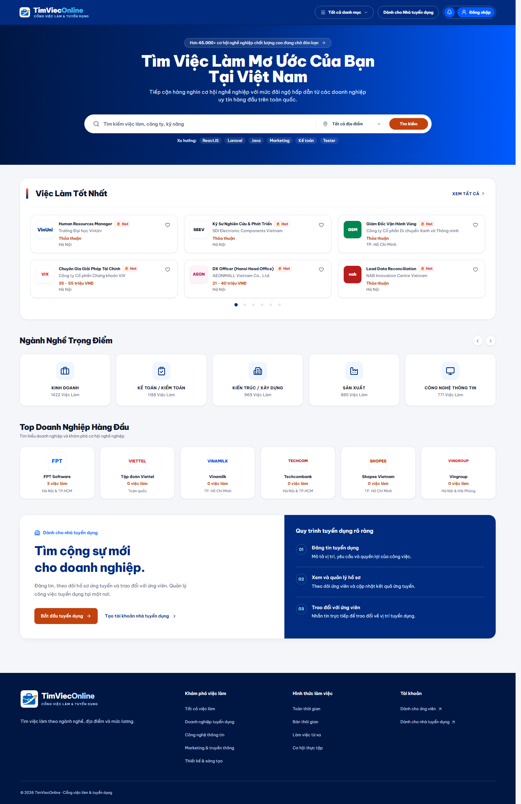
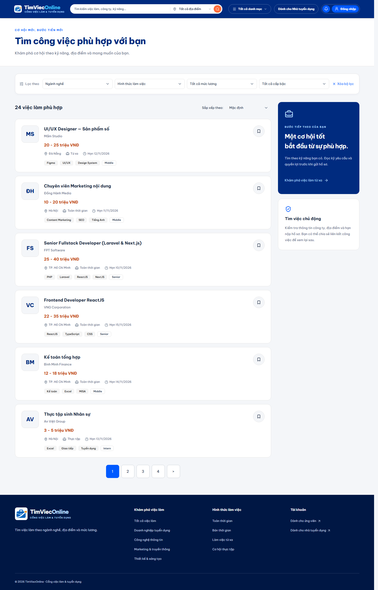
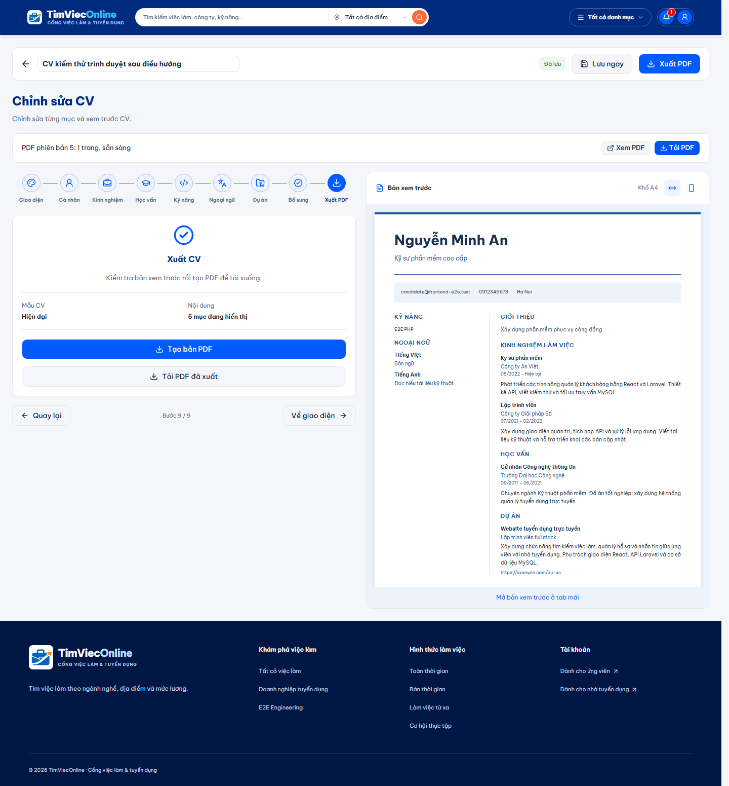
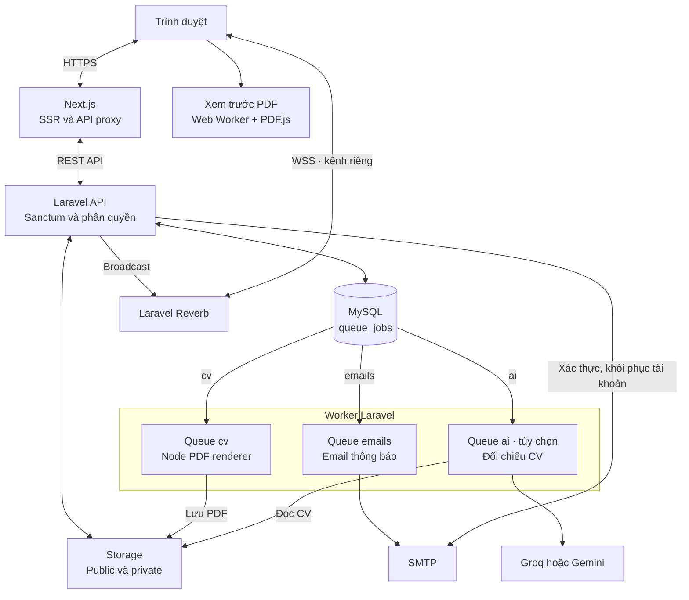

<h1 align="center">TimViecOnline</h1>

Website tuyển dụng gồm trang tìm việc, tài khoản ứng viên, trang quản lý tuyển dụng và trang quản trị. Ứng viên có thể tải CV lên hoặc tạo CV theo mẫu, nộp hồ sơ và trao đổi với nhà tuyển dụng. Backend Laravel quản lý dữ liệu và phân quyền; frontend Next.js phục vụ giao diện.

[Giao diện](#giao-diện-sản-phẩm) · [Kiến trúc](#kiến-trúc) · [Chạy local](#chạy-local) · [Triển khai production](#triển-khai-production) · [Kiểm thử](#kiểm-thử) · [Tài liệu](#tài-liệu)

## Chức năng

| Người dùng     | Chức năng                                                                                                       |
| -------------- | --------------------------------------------------------------------------------------------------------------- |
| Khách          | Tìm và lọc việc làm theo từ khóa, ngành nghề, kỹ năng, địa điểm, mức lương; xem tin và công ty.                 |
| Ứng viên       | Quản lý hồ sơ, kỹ năng, CV; lưu tin; nộp và theo dõi hồ sơ; chat và nhận thông báo.                             |
| Nhà tuyển dụng | Quản lý công ty, đăng/sửa/đóng tin, xem CV, xử lý hồ sơ, chat với ứng viên và xem kết quả đối chiếu CV bằng AI. |
| Quản trị viên  | Xem thống kê, quản lý tài khoản, xử lý tin bị báo cáo và quản lý danh mục ngành nghề/kỹ năng.                   |

Trình tạo CV có sáu mẫu: **Chuyên nghiệp, Hiện đại, Tối giản, Điều hành, Thanh lịch, Chuyên môn**. Bản nháp tự lưu theo revision; hai tab sửa cùng một CV được kiểm tra xung đột. Bản PDF đã nộp được lưu riêng, nên sửa hoặc xóa bản nháp không thay đổi hồ sơ đã gửi. CV PDF giới hạn 5 MB; bản do trình tạo xuất giới hạn thêm 5 trang.

AI là tính năng tùy chọn, tắt mặc định. Khi bật, tác vụ phân tích chạy sau khi nộp hồ sơ và chỉ trả kết quả cho nhà tuyển dụng sở hữu tin hoặc quản trị viên. Kết quả không tự quyết định nhận hay từ chối ứng viên. Trình tạo CV không gọi AI khi chỉnh sửa hoặc xuất PDF.

Nhà tuyển dụng có thể [xuất danh sách ứng viên](docs/applicant-export.md) của một hoặc nhiều tin: một file Excel có sheet riêng cho từng tin, hoặc các file Excel riêng được gói trong ZIP.

## Giao diện sản phẩm

Ảnh từ các lượt kiểm thử giao diện với dữ liệu mẫu. Bấm vào ảnh để xem kích thước đầy đủ.

| Trang chủ                                                                                           | Tìm kiếm việc làm                                                                                        | Tạo và xuất CV                                                                                                                  |
| --------------------------------------------------------------------------------------------------- | -------------------------------------------------------------------------------------------------------- | ------------------------------------------------------------------------------------------------------------------------------- |
| [](docs/images/home.png) | [](docs/images/job-search.png) | [](docs/images/cv-builder.png) |

## Kiến trúc

| Thành phần                  | Công nghệ                                                             |
| --------------------------- | --------------------------------------------------------------------- |
| Frontend                    | Next.js 16, React 19, TypeScript, Tailwind CSS 4, shadcn/ui, Radix UI |
| API                         | Laravel 12, Sanctum, Eloquent                                         |
| Dữ liệu và hàng đợi         | MySQL, Laravel database queue                                         |
| Chat và thông báo trực tiếp | Laravel Reverb, Laravel Echo, Pusher JS                               |
| Tạo và xem CV               | React PDF, PDF.js, font Be Vietnam Pro cục bộ                         |
| Đối chiếu CV                | Groq hoặc Gemini, xử lý tại backend                                   |



[Mở sơ đồ dạng SVG](docs/images/architecture.svg) nếu trình đọc Markdown không hỗ trợ Mermaid.

Các queue dùng chung MySQL nhưng được xử lý bởi worker riêng. Xuất PDF cần Node renderer ở phía worker; xem trước PDF chạy tại trình duyệt. Email thông báo đi qua queue `emails`, còn email xác thực và khôi phục tài khoản được gửi đồng bộ từ API.

```text
backend/         Laravel API, migrations, tác vụ nền và lưu trữ tệp
frontend/        Next.js, giao diện và renderer PDF chạy bằng Node
tests/fixtures/  Dữ liệu dùng chung cho kiểm thử CV
docs/            Nghiệp vụ, cấu hình và hướng dẫn vận hành
postman/         Collection kiểm tra API
```

Trình duyệt gọi proxy `/api/backend/...` của Next.js. Token Sanctum nằm trong cookie `HttpOnly`; Laravel kiểm tra vai trò và quyền sở hữu ở từng API. Ảnh công ty/đại diện dùng public storage. CV và ảnh chat dùng private storage, đọc qua API có kiểm tra quyền.

## Yêu cầu môi trường

- **PHP 8.2 trở lên**, Composer 2; bật `pdo_mysql`, `mbstring`, `fileinfo`, `dom`, `gd`, `openssl` và các extension theo Composer. GD cần cho xử lý ảnh CV.
- **Node.js 22, từ 22.13**, kèm npm. Worker xuất CV phải chạy được Node, kể cả khi frontend nằm trên máy khác.
- **MySQL 8**, database và tài khoản truy cập riêng cho từng môi trường.
- **SMTP** để xác nhận email và khôi phục tài khoản. `MAIL_MAILER=log` chỉ ghi thư vào log.

Phiên bản dependency được khóa tại [composer.lock](backend/composer.lock) và [package-lock.json](frontend/package-lock.json). Cài bằng `composer install` và `npm ci` để dùng đúng các bản đã khóa.

## Chạy local

Các lệnh dưới đây chạy từ thư mục repository, trong terminal riêng cho mỗi tiến trình. Hướng dẫn PowerShell và cách dùng database đã có nằm tại [backend-run-guide.md](docs/backend-run-guide.md).

### 1. Cài backend

```bash
cd backend
composer install
cp .env.example .env
php artisan key:generate
```

Tạo database local rồi điền `DB_*` trong `backend/.env`. Giữ `APP_URL=http://127.0.0.1:8000`, `FRONTEND_URL=http://localhost:3000`. Cấu hình SMTP theo [hướng dẫn email](docs/mail-setup.md); email cần được xác nhận trước khi ứng tuyển, đăng tin hoặc nhắn tin.

Với lần cài đầu:

```bash
php artisan migrate
php artisan db:seed
php artisan storage:link
```

Seeder mặc định tạo danh mục ngành nghề và kỹ năng. Muốn tạo admin, đặt `ADMIN_EMAIL`, `ADMIN_PASSWORD` và tùy chọn `ADMIN_NAME` trước khi seed; mật khẩu tối thiểu 12 ký tự. Không có mật khẩu admin mặc định. Ứng viên và nhà tuyển dụng đăng ký qua giao diện.

Với bản cài đã có dữ liệu, giữ nguyên `.env` và `APP_KEY`, chỉ chạy migration mới. Dữ liệu minh họa quy mô lớn có [hướng dẫn riêng](docs/demo-data.md).

Chạy API:

```bash
php scripts/serve-local.php --port=8000
```

### 2. Cài frontend

Trong terminal mới, từ thư mục repository:

```bash
cd frontend
npm ci
cp .env.example .env.local
```

Các giá trị chính trong `frontend/.env.local`:

```dotenv
AUTH_MODE=api
AUTH_API_URL=http://127.0.0.1:8000/api
AUTH_APP_URL=http://localhost:3000
NEXT_PUBLIC_API_URL=http://127.0.0.1:8000/api
NEXT_PUBLIC_STORAGE_URL=http://127.0.0.1:8000/storage
```

`AUTH_APP_URL` phải khớp origin đang mở trên trình duyệt, gồm cả cổng. `AUTH_MODE=mock` chỉ dùng cho demo frontend riêng; khi chạy API thật, lỗi kết nối không tự chuyển sang dữ liệu mock.

```bash
npm run build:cv-renderer
npm run dev
```

Mở **http://localhost:3000**. API chạy ở **http://127.0.0.1:8000**.

### 3. Bật các dịch vụ cần dùng

Các lệnh này chạy trong `backend/`, mỗi dòng ở một terminal riêng:

```bash
php artisan reverb:start --host=127.0.0.1 --port=8080
php artisan queue:work database --queue=emails --sleep=1 --tries=3 --timeout=30
php artisan queue:work database --queue=cv --sleep=1 --tries=2 --timeout=45
```

- **Chat:** đặt cùng public key cho `REVERB_APP_KEY` và `NEXT_PUBLIC_REVERB_APP_KEY`; cấu hình frontend kết nối `localhost:8080`, scheme `http`. Tạo app ID/key/secret riêng, không dùng giá trị `replace-with-...` trong ví dụ.
- **Tạo CV:** đặt `RESUME_BUILDER_ENABLED=true` ở backend sau khi build renderer. Flag này tắt mặc định. Xem [cấu hình CV](docs/cv-builder-setup.md) về Node, GD và font.
- **AI:** nếu cần, cấu hình provider, model và key theo [hướng dẫn AI](docs/ai-setup.md), rồi chạy worker riêng cho queue `ai` với `--tries=3 --timeout=60`.

Sau khi sửa cấu hình Laravel, chạy `php artisan config:clear` và khởi động lại tiến trình liên quan. Thay biến `NEXT_PUBLIC_*` cần khởi động lại frontend dev hoặc build lại bản production. Lịch đóng tin hết hạn có thể chạy local bằng `php artisan schedule:work`.

## Triển khai production

### Cấu hình

Chạy Laravel qua Nginx/Apache và PHP-FPM, document root là `backend/public`. Chạy Next.js và Reverb phía sau reverse proxy HTTPS; proxy Reverb phải chuyển tiếp kết nối WebSocket. Các server dùng để phát triển ở phần local không thay thế cấu hình này.

Ví dụ dưới đây dùng `jobs.example.com` cho website, `api.example.com` cho API và `ws.example.com` cho WebSocket. Thay bằng tên miền của hệ thống trước khi build.

Backend:

```dotenv
APP_ENV=production
APP_DEBUG=false
APP_URL=https://api.example.com
FRONTEND_URL=https://jobs.example.com
APP_TIMEZONE=Asia/Ho_Chi_Minh
QUEUE_CONNECTION=database
DB_QUEUE_RETRY_AFTER=90
MAIL_MAILER=smtp
BROADCAST_CONNECTION=reverb
REVERB_HOST=ws.example.com
REVERB_PORT=443
REVERB_SCHEME=https
REVERB_ALLOWED_ORIGINS=jobs.example.com
RESUME_BUILDER_ENABLED=true
AI_ANALYSIS_ENABLED=false
```

Frontend:

```dotenv
AUTH_MODE=api
AUTH_API_URL=https://api.example.com/api
AUTH_APP_URL=https://jobs.example.com
NEXT_PUBLIC_API_URL=https://api.example.com/api
NEXT_PUBLIC_STORAGE_URL=https://api.example.com/storage
NEXT_PUBLIC_REVERB_HOST=ws.example.com
NEXT_PUBLIC_REVERB_PORT=443
NEXT_PUBLIC_REVERB_SCHEME=https
```

Đây là các giá trị cần đổi khi triển khai, không phải toàn bộ cấu hình. Điền thêm kết nối database, SMTP, `APP_KEY`, Reverb app ID/key/secret trong môi trường riêng. `NEXT_PUBLIC_REVERB_APP_KEY` phải khớp public key của backend. Chỉ các giá trị công khai được đặt trong `NEXT_PUBLIC_*`; giữ mật khẩu, token và provider key ở backend. Tạo `APP_KEY` một lần khi cài mới, giữ nguyên qua các bản phát hành.

`AUTH_API_URL` là địa chỉ Next server gọi được. Với API ở máy/container khác, cấu hình hiện tại yêu cầu HTTPS; HTTP chỉ được chấp nhận cho loopback. Giữ `AUTH_APP_URL`, `FRONTEND_URL` và Reverb allowed origins khớp tên miền website.

### Build và phát hành

Chuẩn bị release mới với cấu hình đúng, sao lưu database và tệp người dùng trước khi cập nhật. Từ thư mục repository:

```bash
cd backend
composer install --no-dev --prefer-dist --no-interaction --optimize-autoloader
composer check-platform-reqs --no-dev

cd ../frontend
npm ci
npm run build:cv-renderer
npm run build
```

Sau khi build thành công, trong `backend/`:

```bash
php artisan migrate --force
```

Lần cài đầu cần nạp danh mục bằng `php artisan db:seed --force`. Seeder admin đọc biến môi trường, vì vậy thực hiện bước tạo admin trước các lệnh cache bên dưới. Các lần cập nhật giữ nguyên dữ liệu và khóa ứng dụng.

Gắn storage bền vững vào release trước khi tạo public storage link. Mỗi release mới cần tạo hoặc kiểm tra `backend/public/storage` trỏ đúng đến `storage/app/public` dùng chung, rồi mới chuyển lưu lượng sang release đó.

```bash
php artisan storage:link
php artisan config:cache
php artisan route:cache
php artisan view:cache
```

Giữ các tệp sau khi phát hành:

- `frontend/.next`, `frontend/public`, `frontend/package.json` và dependency runtime trong `frontend/node_modules`.
- `frontend/dist/cv-renderer/render-cv.mjs` cùng `frontend/public/fonts/resumes`; worker Laravel phải truy cập được các đường dẫn này. Chỉ chép file `.mjs` sang máy khác là chưa đủ.
- `backend/storage` trên volume bền vững; user chạy API/worker có quyền ghi `storage` và `bootstrap/cache`. Public link chỉ trỏ đến `storage/app/public`; CV và ảnh chat trong private storage đi qua API.

Chuyển sang release mới rồi khởi động lại Next.js, worker và Reverb qua process manager. Dùng `php artisan queue:restart` để worker thoát sau tác vụ hiện tại và `php artisan reverb:restart` để nạp lại Reverb; process manager phải tự chạy lại chúng. Reload PHP-FPM nếu cấu hình OPcache cần nạp lại mã nguồn.

### Tiến trình và lịch chạy

Dùng Supervisor, systemd hoặc trình quản lý tiến trình của môi trường triển khai để giữ các dịch vụ chạy và thu log.

| Tiến trình      | Lệnh / cách chạy                                                                  |
| --------------- | --------------------------------------------------------------------------------- |
| Laravel API     | PHP-FPM phục vụ `backend/public/index.php` qua web server                         |
| Next.js         | Trong `frontend/`: `npm run start -- --hostname 127.0.0.1 --port 3000`            |
| Reverb          | Trong `backend/`: `php artisan reverb:start --host=127.0.0.1 --port=8080`         |
| Email thông báo | `php artisan queue:work database --queue=emails --sleep=1 --tries=3 --timeout=30` |
| Xuất PDF        | `php artisan queue:work database --queue=cv --sleep=1 --tries=2 --timeout=45`     |
| AI, khi bật     | `php artisan queue:work database --queue=ai --sleep=1 --tries=3 --timeout=60`     |

Các worker chạy từ `backend/` và dùng cùng database/storage với API. Database queue dùng bảng `queue_jobs`; `retry_after` phải lớn hơn timeout worker. Chạy `queue:work` không chỉ định queue sẽ không xử lý các queue `emails`, `cv`, `ai` này.

Cho cron chạy lệnh sau mỗi phút, với working directory là `backend/` và user vận hành ứng dụng:

```bash
php artisan schedule:run
```

Lịch hiện có đóng tin hết hạn lúc **00:05 theo `APP_TIMEZONE`**. Xem lịch bằng `php artisan schedule:list`. Email xác nhận tài khoản, khôi phục và xác nhận đổi mật khẩu hiện gửi đồng bộ; worker `emails` xử lý email thông báo theo tùy chọn người dùng.

### Kiểm tra sau phát hành

1. Đọc `/up` và `/api/categories`: endpoint đầu kiểm tra ứng dụng khởi động được, endpoint sau kiểm tra thêm kết nối dữ liệu.
2. Đăng nhập, xác nhận email thử qua hộp thư do đội vận hành kiểm soát; tạo tin và ứng tuyển bằng tài khoản kiểm tra.
3. Tạo CV, sửa rồi tải lại, xuất và tải PDF; kiểm tra worker `cv` xử lý xong tác vụ.
4. Gửi chat giữa hai tài khoản, kiểm tra cập nhật trực tiếp và email thông báo nếu được bật.

Trong `backend/`, các lệnh kiểm tra vận hành gồm:

```bash
php artisan mail:check
php artisan resumes:health
php artisan queue:failed
php artisan resumes:prune --dry-run
```

`mail:check` không gửi thư khi thiếu `--to`; nó chỉ kiểm tra đủ trường cấu hình. `resumes:health` trả mã thoát khác 0 khi export bị kẹt quá hai phút. Xem dry-run trước khi chạy dọn file thật. Đặt cảnh báo cho tác vụ thất bại, tồn đọng hàng đợi, dung lượng storage và lỗi SMTP/WebSocket.

Sao lưu cả MySQL lẫn tệp công khai/riêng tư và kiểm tra khả năng khôi phục. Khi rollback, giữ dữ liệu CV đã nộp và kiểm tra tương thích schema với release cũ trước khi chuyển mã nguồn.

Kết quả đo local của CV chưa đạt mục tiêu lưu p95 dưới 500 ms ở 50 người dùng đồng thời. Xem [báo cáo kiểm chứng CV](docs/cv-builder-verification.md) và [ghi nhận hiệu suất](docs/performance.md); cần đo lại trên hạ tầng triển khai trước khi mở rộng tải.

## Kiểm thử

Backend dùng database có thể xóa, tách khỏi dữ liệu phát triển/vận hành. Đặt `DB_DATABASE` và `TEST_DB_NAME` giống nhau, tên kết thúc bằng `_test`, không dùng `DB_URL` hoặc config cache của production. Chuẩn bị theo [hướng dẫn kiểm thử backend](BACKEND_TESTING_GUIDE.md) trước khi chạy:

```bash
cd backend
php artisan test
```

Frontend, từ `frontend/` sau khi cài dependency PHP và Node:

```bash
npx playwright install chromium
npm run lint
npm run typecheck
npm test
npm run test:mock-auth
npm run test:cv-renderer
npm run test:cv-preview
npm run test:cv-lifecycle
npm run build
```

E2E dùng Laravel thật cần MySQL/MariaDB disposable ở `127.0.0.1:33063`. Fixture reset riêng database `frontend_api_e2e_test`, dùng cổng API/Reverb/SMTP/Next riêng và không gửi email ra ngoài. Cách cấu hình nằm ở [hướng dẫn tích hợp](docs/backend-frontend-integration.md#kiểm-thử). Sau khi chuẩn bị môi trường và build với cấu hình fixture, chạy trong `frontend/`:

```bash
npx playwright test --config playwright.backend.config.ts tests/e2e/backend-resume-builder.spec.ts
```

GitHub Actions định nghĩa các bước kiểm tra tại [backend.yml](.github/workflows/backend.yml) và [frontend.yml](.github/workflows/frontend.yml). Các bài thử dùng dịch vụ giả lập hoặc hạ tầng disposable; chất lượng AI, SMTP thật và tải production cần được kiểm tra riêng.

## Tài liệu

| Nội dung                        | Đường dẫn                                                                                   |
| ------------------------------- | ------------------------------------------------------------------------------------------- |
| Nghiệp vụ và yêu cầu            | [SRS](docs/SRS.md)                                                                          |
| Chạy hằng ngày trên Windows     | [Backend run guide](docs/backend-run-guide.md)                                              |
| Xác thực, proxy và tích hợp API | [Frontend–backend integration](docs/backend-frontend-integration.md)                        |
| Hợp đồng API và Postman         | [API checklist](API_CHECKLIST.md), [Postman](postman/README.md)                             |
| SMTP và thông báo email         | [Mail setup](docs/mail-setup.md)                                                            |
| Trình tạo CV và xuất PDF        | [CV setup](docs/cv-builder-setup.md), [kết quả kiểm chứng](docs/cv-builder-verification.md) |
| Provider và worker AI           | [AI setup](docs/ai-setup.md)                                                                |
| Hiệu suất và lỗi local          | [Performance](docs/performance.md)                                                          |
| Dữ liệu minh họa                | [Demo data](docs/demo-data.md), [nguồn thông tin công ty](docs/real-company-data.md)        |

## Giấy phép

Mã nguồn được phát hành theo [MIT](LICENSE). Font Be Vietnam Pro đi kèm có [giấy phép OFL riêng](frontend/public/fonts/resumes/OFL.txt).
